# 🏃 STRAVA FITNESS DATA ANALYTICS CASE STUDY

### Transforming Fitness Data into Actionable Business Intelligence

<p align="center">
  
  
  
  
  
</p>

<p align="center">
  <b>Python | SQL | Power BI | Exploratory Data Analysis | Data Visualization</b>
</p>

---

## 📑 Table of Contents

- [Project Overview](#-project-overview)
- [Business Problem](#-business-problem)
- [Project Objectives](#-project-objectives)
- [Technology Stack](#-technology-stack)
- [Analytical Workflow](#-analytical-workflow)
- [Key Performance Indicators](#-key-performance-indicators)
- [Power BI Dashboard](#-power-bi-dashboard)
- [Python Analysis](#-python-analysis--google-colab)
- [SQL Analysis](#-sql-analysis)
- [Business Recommendations](#-business-recommendations)
- [Repository Structure](#-repository-structure)
- [Getting Started](#-getting-started)
- [Dataset and Data Privacy](#-dataset-and-data-privacy)
- [Limitations](#-limitations)
- [Future Enhancements](#-future-enhancements)
- [Author](#-author)

---

## 📌 Project Overview

The **STRAVA FITNESS DATA ANALYTICS CASE STUDY** is an end-to-end data analytics project focused on understanding fitness activity, user behavior, movement patterns, and wellness indicators.

The project combines Python-based exploratory data analysis (EDA), SQL querying, and Power BI dashboards to transform raw fitness records into meaningful insights.

The analytical process includes data cleaning, data validation, descriptive statistics, activity analysis, correlation analysis, KPI development, data visualization, and business recommendations.

**Project Goal:** Turn fitness data into actionable insights that support data-driven decisions about activity tracking, user engagement, and wellness.

## 🎯 Business Problem

Fitness tracking applications collect large amounts of information about physical activity and user behavior. However, raw data does not automatically explain activity patterns or identify opportunities to improve user engagement.

This project examines available fitness metrics to understand user activity, compare movement patterns, explore recorded sleep behavior, and identify opportunities for personalized fitness experiences.

The analysis uses data-driven evidence to support recommendations rather than relying on assumptions.

## 🎯 Project Objectives

- Analyze daily steps, distance covered, and calories burned.
- Explore hourly activity patterns and user participation.
- Examine recorded sleep duration and wellness indicators.
- Investigate relationships between physical activity metrics.
- Compare activity patterns across users.
- Develop meaningful KPIs and visualizations.
- Present actionable business recommendations.

## 🛠️ Technology Stack

| Technology | Purpose |
|---|---|
| Python | Data processing and analysis |
| Pandas | Data cleaning and manipulation |
| NumPy | Numerical calculations |
| Matplotlib | Data visualization |
| Seaborn | Statistical and relationship analysis |
| MySQL | Data validation and SQL analysis |
| Power BI | Interactive dashboards and KPI reporting |
| Google Colab | Cloud-based Python analysis |
| Git & GitHub | Version control and documentation |

## 🔄 Analytical Workflow

### 1. Data Understanding
- Inspect datasets, columns, data types, and record counts.
- Understand available activity and sleep metrics.
- Identify potential data quality issues.

### 2. Data Cleaning and Validation
- Check duplicate records and missing values.
- Validate date fields and numerical columns.
- Investigate inconsistent or implausible values.
- Prepare analysis-ready datasets.

### 3. Exploratory Data Analysis
- Calculate descriptive statistics.
- Analyze activity distributions and daily patterns.
- Compare activity across users.
- Explore relationships between key variables.

### 4. SQL Analysis
- Validate record counts and data quality.
- Perform aggregations and grouped analysis.
- Analyze user activity and sleep records.
- Extract insights using SQL queries.

### 5. Power BI Dashboard Development
- Design KPI cards and analytical charts.
- Create focused dashboard pages.
- Analyze activity, calorie expenditure, sleep, and relationships.
- Present insights through interactive visualizations.

### 6. Insights and Recommendations
- Interpret analytical results.
- Identify potential engagement opportunities.
- Recommend practical improvements.
- Document limitations and future enhancements.

## 📊 Key Performance Indicators

| KPI | Analytical Purpose |
|---|---|
| Total Users | Understand dataset coverage |
| Average Daily Steps | Evaluate recorded daily movement |
| Average Sleep Duration | Examine recorded sleep behavior |
| Average Calories Burned | Understand recorded energy expenditure |
| Average Distance Covered | Measure movement patterns |
| Average Hourly Activity | Identify activity patterns over time |
| User Activity Segmentation | Compare users by activity behavior |

*Populate KPI values using validated analysis results. Define each metric's unit, aggregation level, and calculation method.*

## 📊 Power BI Dashboard

The Power BI dashboard presents fitness metrics and user activity through multiple analytical report pages.

### 🏠 Home Page

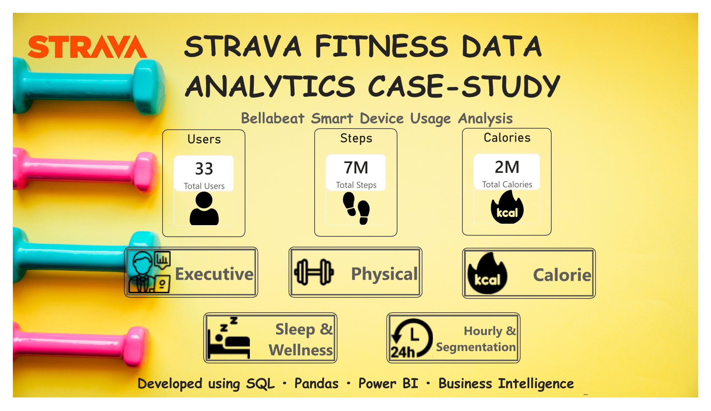

### 📈 Executive Overview

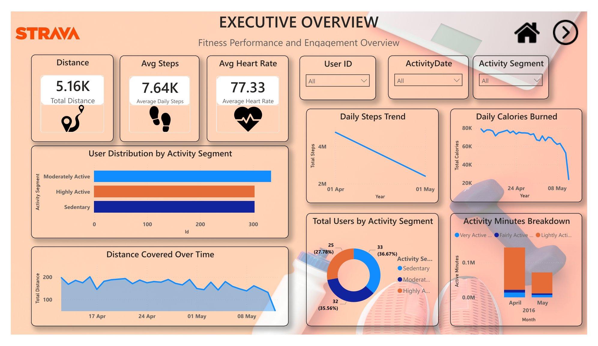

### 🔥 Calorie Expenditure Analysis

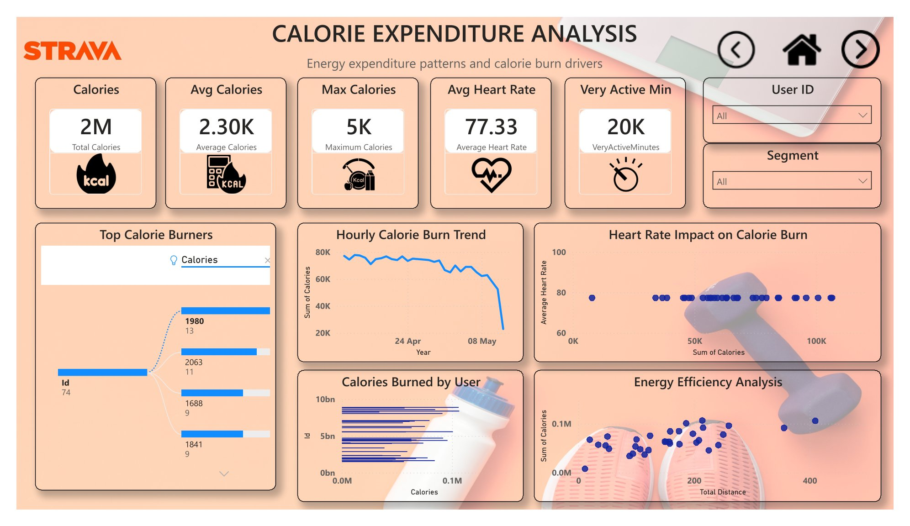

### ⏱️ Hourly Activity and User Segmentation

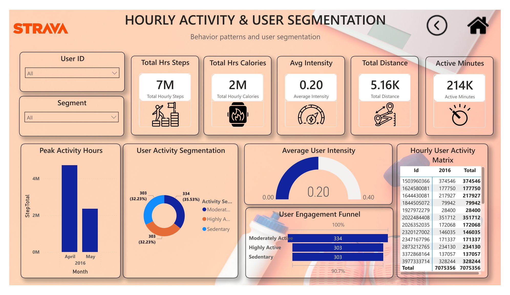

### 🚶 Physical Activity Analysis

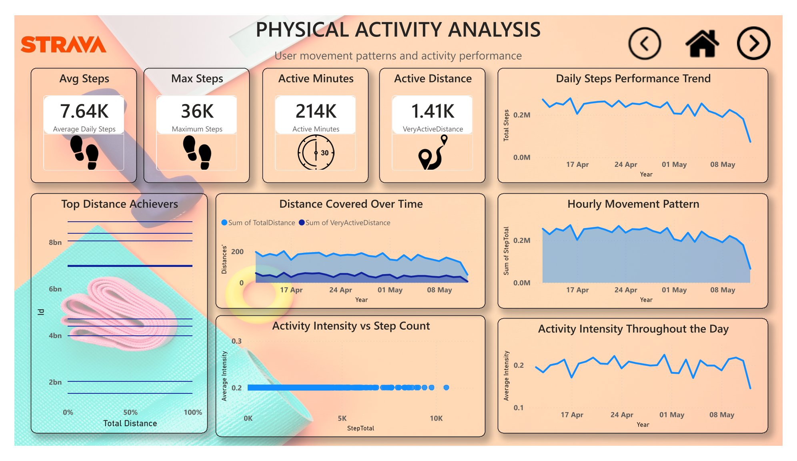

### 😴 Sleep and Wellness Analysis

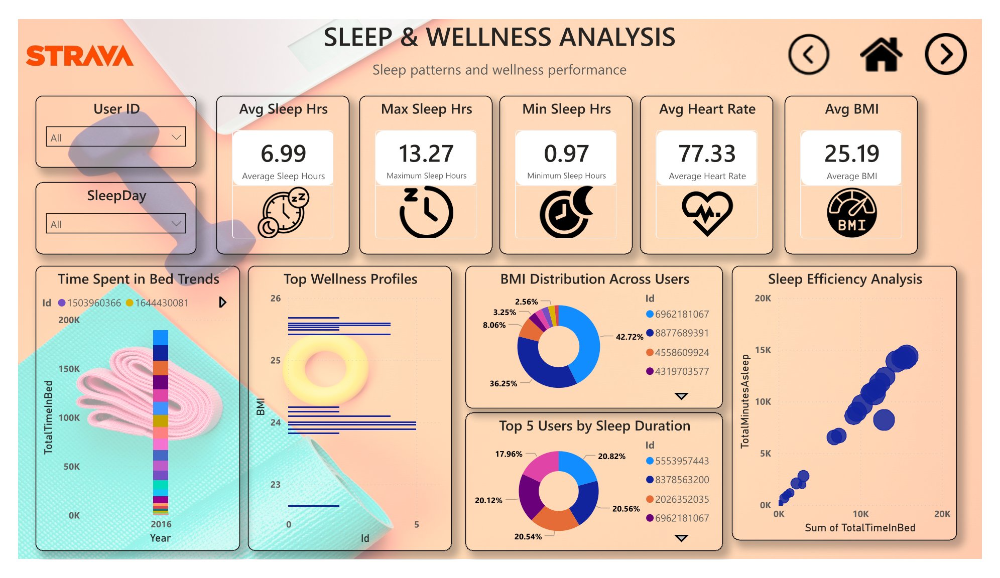

### 🔗 Relationship Analysis

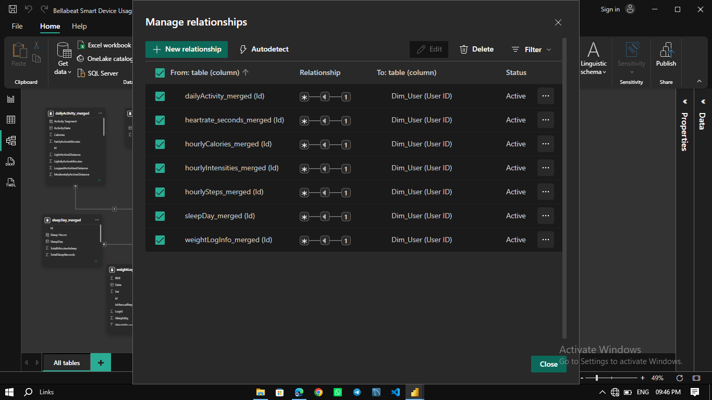

### 🗂️ Power BI Data Model

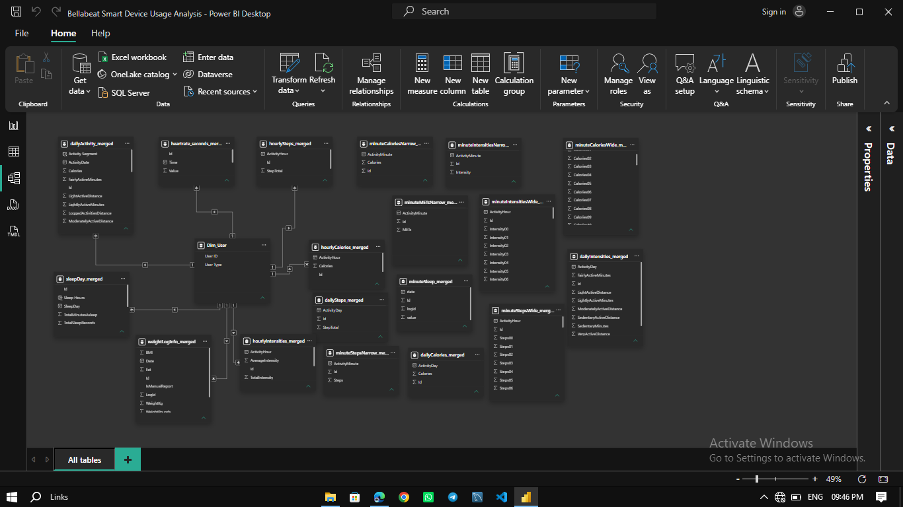

## 🐍 Python Analysis — Google Colab

Python was used to perform exploratory analysis, calculate summary metrics, examine relationships, and visualize activity patterns.

### 📈 Average Hourly Activity

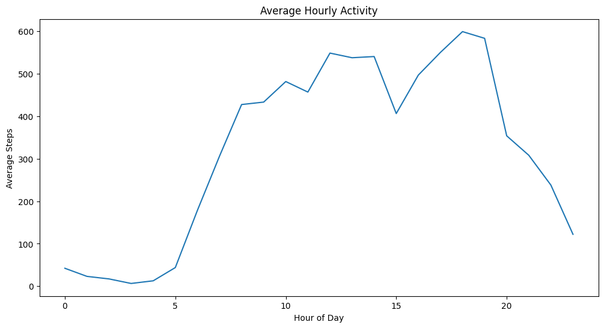

### 🔥 Correlation Matrix

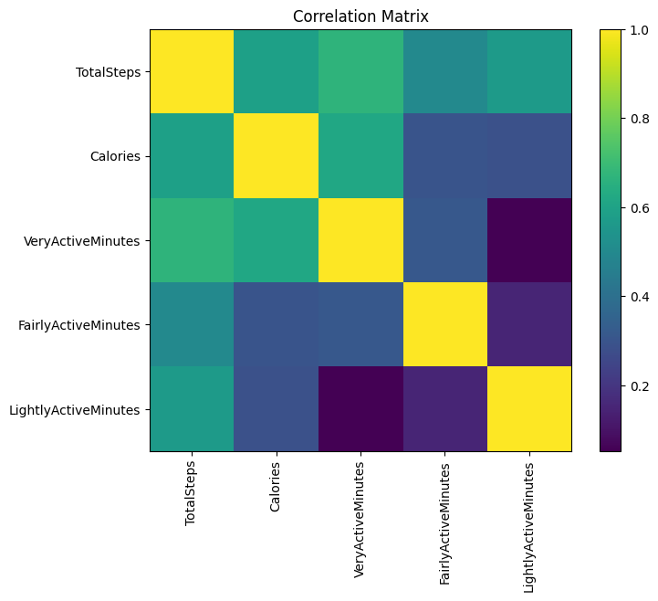

### 📊 Distribution of Daily Steps

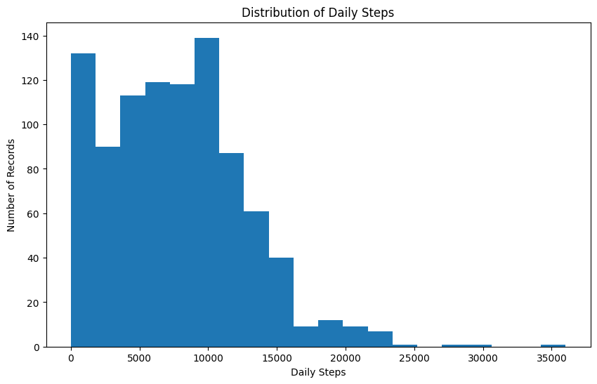

### 🎯 KPI Analysis


### 😴 Sleep Duration Distribution

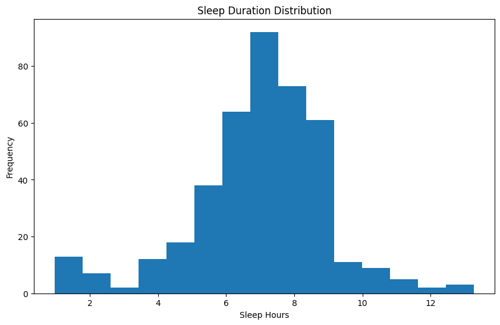

### 🔍 Steps vs. Calories Burned

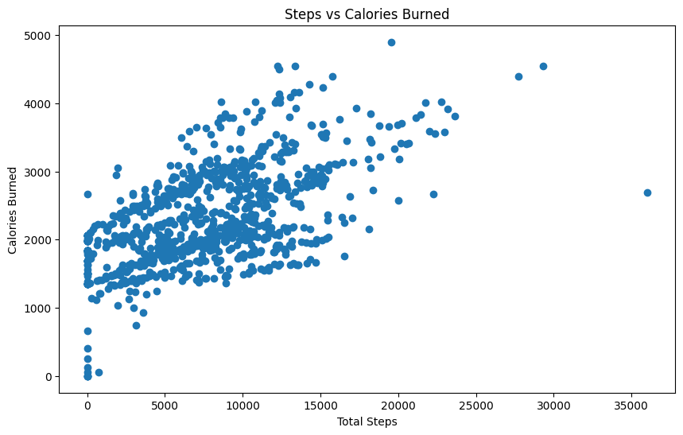

### 🏆 Top 10 Most Active Users

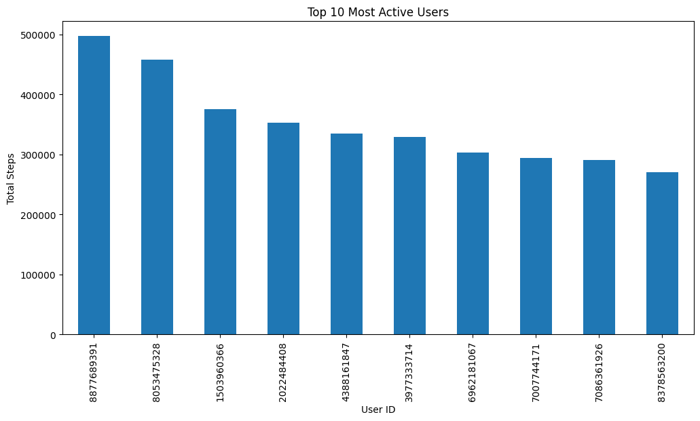

### 👥 User Activity Segmentation

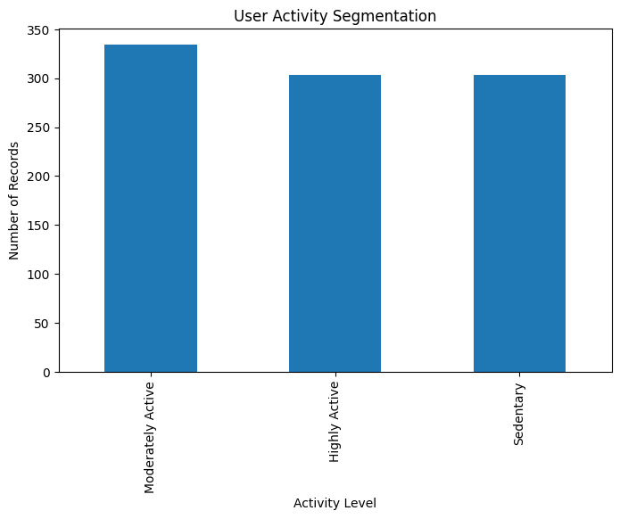

## 🗄️ SQL Analysis

SQL is used to validate records, investigate data quality, summarize metrics, and support structured analysis.

Key activities include:

- Record count validation.
- Duplicate detection.
- Missing-value checks.
- Aggregation of activity and sleep metrics.
- Grouped analysis by user and time period.
- Preparation of analytical results.

**SQL script:** `sql/fitness_data_analysis.sql`

Use the database and table names defined in the actual SQL script.

## 💡 Business Recommendations

| Business Area | Recommendation | Intended Outcome |
|---|---|---|
| Engagement | Introduce personalized activity goals | Encourage consistent participation |
| Motivation | Implement challenges and rewards | Support ongoing engagement |
| Notifications | Provide relevant activity reminders | Encourage regular movement |
| Wellness | Offer evidence-based sleep education | Improve wellness awareness |
| Segmentation | Group users by activity patterns | Enable relevant user experiences |
| Retention | Monitor engagement trends | Identify opportunities for improvement |

*These recommendations are proposals. Their effectiveness should be measured using actual engagement metrics and appropriate experiments.*

## 📦 Project Deliverables

- Python analysis notebook.
- SQL data validation and analysis scripts.
- Power BI dashboard.
- KPI calculations and exploratory visualizations.
- Google Colab analysis screenshots.
- Power BI dashboard screenshots.
- Final analytical report, if included.
- Business insights and recommendations.

## 📂 Repository Structure

```text
strava-fitness-data-analytics-case-study/
│
├── data/
│   └── README.md
│
├── notebooks/
│   └── fitness_data_analysis.ipynb
│
├── sql/
│   └── fitness_data_analysis.sql
│
├── dashboardScreenshot/
│   ├── home-page.png
│   ├── executive-overview.png
│   ├── calorie-expenditure-analysis.png
│   ├── hourly-activity-and-user-segmentation.png
│   ├── physical-activity-analysis.png
│   ├── sleep-and-wellness-analysis.png
│   ├── relationship-analysis.png
│   └── data-model.png
│
├── notebookScreenshots/
│   ├── Average-Hourly-Activity.png
│   ├── Correlation-Matrix.png
│   ├── Distribution-of-Daily-Steps.png
│   ├── KPI-Section.png
│   ├── Sleep-Duration-Distribution.png
│   ├── Steps-vs-Calories-Burned.png
│   ├── Top-10-Most-Active-Users.png
│   └── User-Activity-Segmentation.png
│
├── reports/
│   └── README.md
│
├── README.md
├── requirements.txt
└── .gitignore
```

*This structure is illustrative. Keep the filenames synchronized with your actual repository contents. Include your `.pbix` file and final report if you intend to share them.*

## 🚀 Getting Started

### Prerequisites

- Python 3.10 or a compatible version.
- Jupyter Notebook or Google Colab.
- MySQL Server and MySQL Workbench for local SQL execution.
- Power BI Desktop to open the `.pbix` file, if provided.

### 1. Clone the Repository

```bash
git clone https://github.com/YOUR-USERNAME/strava-fitness-data-analytics-case-study.git
cd strava-fitness-data-analytics-case-study
```

Replace `YOUR-USERNAME` with your GitHub username.

### 2. Create a Virtual Environment

```bash
python -m venv .venv
```

Activate the environment on Windows:

```bash
.venv\Scripts\activate
```

### 3. Install Dependencies

```bash
pip install -r requirements.txt
```

### 4. Launch Jupyter Notebook

```bash
jupyter notebook
```

Open the notebook inside the `notebooks/` directory.

Alternatively, upload the notebook to Google Colab and configure the dataset paths.

### 5. Execute SQL Analysis

1. Start MySQL Server.
2. Create the database required by the SQL script.
3. Import the source tables.
4. Verify the table and column names.
5. Execute the queries and validate the results.

### 6. Open the Power BI Dashboard

Open the `.pbix` file in Power BI Desktop if it is included. Update data source paths and refresh the data when necessary.

## 📁 Dataset and Data Privacy

Document the original dataset provider, source URL, collection period, available fields, license, and usage restrictions.

**Data attribution is important:** If this analysis uses the Bellabeat case-study dataset containing Fitbit-style activity records, identify that source accurately. A repository title containing "STRAVA" does not prove that the data originated from Strava.

Do not upload sensitive or restricted data, credentials, connection strings, or datasets you do not have permission to redistribute. When redistribution is prohibited, provide instructions for obtaining the dataset from its authorized source.

## ⚠️ Limitations

- Findings depend on dataset completeness and accuracy.
- Correlation does not establish causation.
- The dataset may not represent all fitness-app users.
- Recorded activity and sleep metrics may not capture every aspect of wellness.
- Missing observations and tracking differences can affect comparisons.
- Business recommendations require further validation.

## 🔮 Future Enhancements

- Introduce time-series analysis of activity trends.
- Improve activity segmentation and comparative reporting.
- Enhance dashboard navigation and interactivity.
- Automate data quality validation.
- Explore predictive analytics when suitable data is available.
- Evaluate engagement strategies using measurable outcomes.
- Document reproducible data refresh procedures.

## 👤 Author

**Ayush Dash**

Data Analytics | Python | SQL | Power BI | Exploratory Data Analysis

GitHub: [YOUR-USERNAME](https://github.com/YOUR-USERNAME)

---

## ⭐ Acknowledgements

Thanks to the dataset providers and open-source communities whose resources support data analytics, visualization, and reporting.

---

<p align="center">
  <b>Turning Data into Insights. Insights into Action.</b>
</p>
